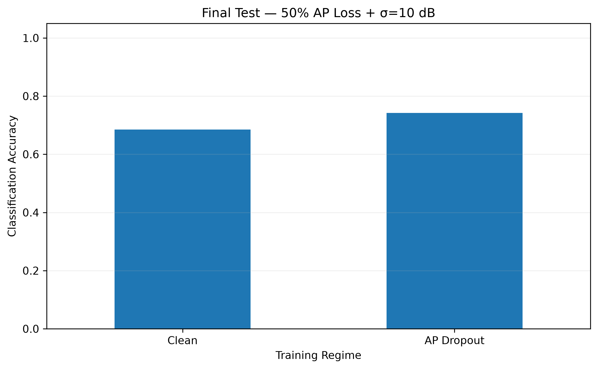
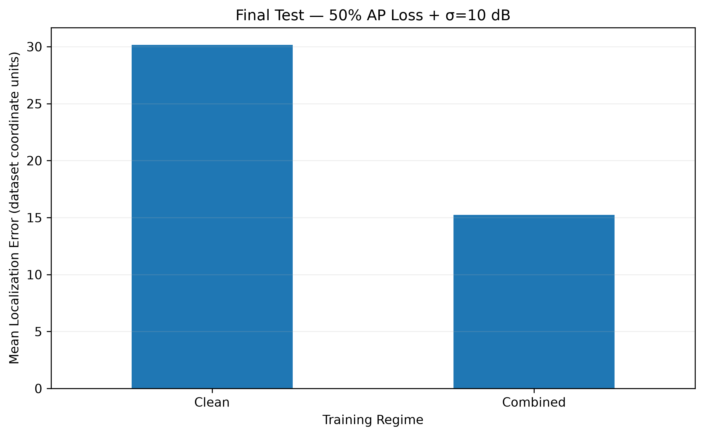
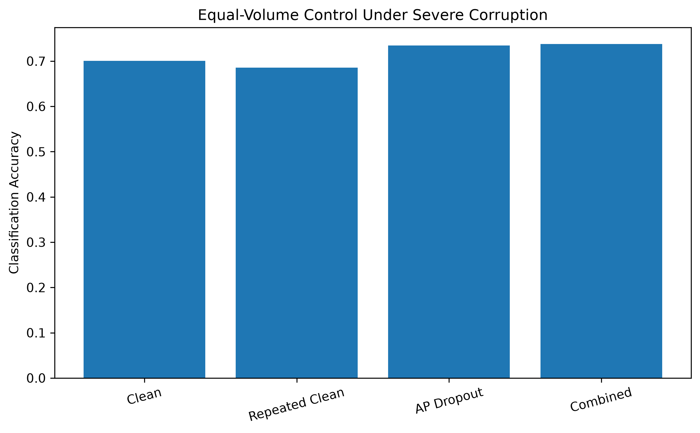
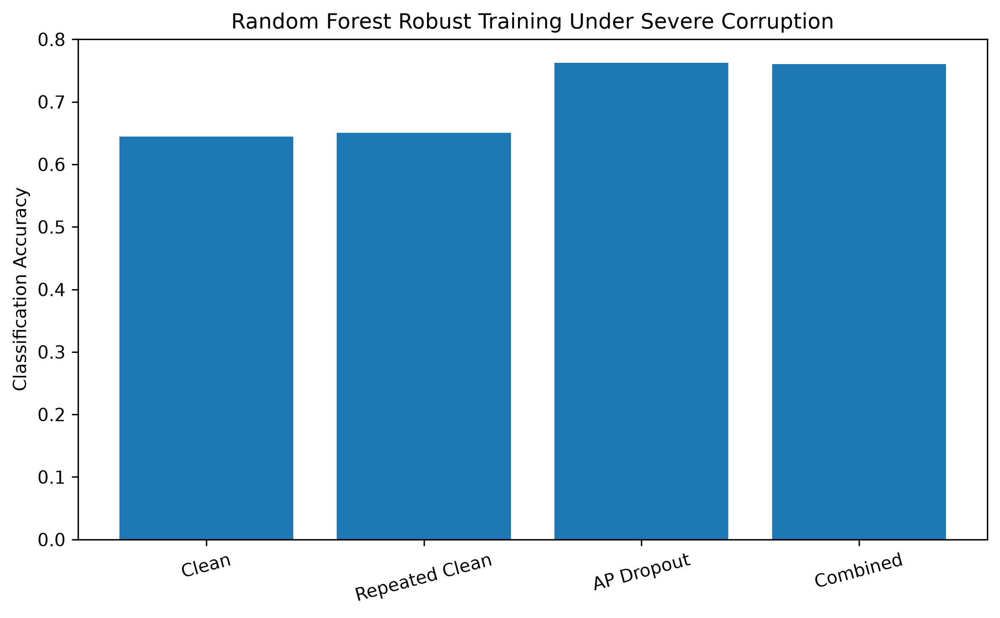

<div align="center">

# Robust Wi-Fi Fingerprint Indoor Localization

### Under Access-Point Loss and RSSI Noise

[](https://www.python.org/)
[](https://scikit-learn.org/)
[](https://jupyter.org/)
[](https://archive.ics.uci.edu/dataset/310/ujiindoorloc)
[](#citation)
[](LICENSE)

**How do Wi-Fi localization models fail when access points disappear, and can simple
corruption-aware training make them degrade gracefully?**

[Key results](#key-results) · [Method](#method-at-a-glance) · [Quick start](#quick-start) ·
[Notebooks](#notebook-guide) · [Reproducibility](#reproducibility-protocol) · [Citation](#citation)

</div>

---

## Overview

Wi-Fi fingerprinting localizes a device from the signal strengths (RSSI) of nearby access points (APs).
It works well on clean benchmark data, but in real buildings APs go offline and readings fluctuate.
This repository contains the complete, auditable pipeline behind our study of those two failure modes
on the public **UJIIndoorLoc** benchmark (3 buildings, 13 building-floor classes, 520 APs):

- **Two tasks:** building-floor classification and 2-D coordinate localization.
- **Three model families:** K-nearest neighbors, Random Forest and a multilayer perceptron (MLP).
- **A 6 × 4 corruption grid:** loss of 0–50 % of the APs *actually observed* in each fingerprint, crossed
  with Gaussian RSSI noise of σ = 0, 2, 5 and 10 dB.
- **Corruption-aware training:** AP-dropout, RSSI-noise and combined augmentation.
- **A frozen held-out test set** (1,111 fingerprints), never used for model selection, with paired-bootstrap
  confidence intervals.

> [!IMPORTANT]
> **Main finding.** Losing access points is far more damaging than RSSI noise. Training on fingerprints with
> randomly dropped APs recovers a large part of the lost performance, and equal-volume repetition of clean
> training data did not reproduce the robustness gain.

<p align="center">
  
  &nbsp;
  
</p>
<p align="center"><sub>Held-out performance under the severe condition: 50 % detected-AP loss plus σ = 10 dB RSSI noise.</sub></p>

---

## Key results

### Primary analysis (frozen held-out test set)

Severe condition: **50 % detected-AP loss + σ = 10 dB RSSI noise**, five corruption seeds.

| Task | Clean-trained MLP | Robust MLP | Improvement | 95 % CI |
|---|---:|---:|---:|---:|
| Building-floor accuracy (AP-dropout) | 68.53 % | **74.24 %** | **+5.71 pp** | [+4.41, +7.06] pp |
| Mean localization error (combined) | 30.16 | **15.24** | **−49.5 %** | [14.21, 15.63] units reduction |
| Clean-input accuracy (AP-dropout) | 91.09 % | 90.55 % | −0.54 pp | [−1.80, +0.63] pp |

Across all 24 grid conditions, AP-dropout training raised mean accuracy from 0.822 to 0.848, and combined
augmentation cut mean localization error from 18.60 to 11.93 coordinate units.

### Reviewer-requested controls (post-hoc)

These analyses were added during peer review, after the primary test evaluation was frozen. They test
specific threats to interpretation and were **not** used to change model selection.

| Question | Control | Result (severe condition) |
|---|---|---|
| Is the gain just more training data? | Repeated-clean model trained on the **same number of instances** (43,062) | AP-dropout still **+4.86 pp** accuracy; combined still **−16.42 units (−50.1 %)** error |
| Is it specific to the MLP? | Same augmentation applied to **Random Forest** | **+11.18 pp** accuracy; **−21.15 units (−54.6 %)** error |
| Are five seeds enough? | **20 corruption seeds** (42–61) | MLP **+5.20 pp** / **−16.28 units**; RF **+11.25 pp** / **−21.07 units** |
| Does it hold for shared outages? | **Global AP outage**: the same APs removed from every fingerprint | At 50 % outage: **+5.42 pp** (no noise), **+4.36 pp** (σ = 10 dB) for the MLP |

The 20-seed crossed-bootstrap 95% confidence intervals were:

- MLP classification gain: **+5.20 pp**, 95% CI **[+4.05, +6.44] pp**
- RF classification gain: **+11.25 pp**, 95% CI **[+9.96, +12.57] pp**
- MLP localization-error reduction: **16.28 units**, 95% CI **[15.26, 17.30]**
- RF localization-error reduction: **21.07 units**, 95% CI **[19.76, 22.44]**

A descriptive two-way variance decomposition found that corruption-seed identity accounted for at most
**0.10%** of paired-effect variation; most variation arose from fingerprint identity and seed-by-fingerprint
interaction. This is reported as a sensitivity summary rather than a fitted population random-effects model.

<p align="center">
  
  &nbsp;
  
</p>
<p align="center"><sub>Left: equal-volume control (MLP). Right: Random Forest with augmentation.</sub></p>

> [!NOTE]
> Localization errors are in **dataset coordinate units**, the planar coordinates supplied with UJIIndoorLoc.
> They have not been converted to verified meters, so a 16-unit reduction is not a 16 m improvement.

---

## Method at a glance

```mermaid
flowchart LR
    A[UJIIndoorLoc<br/>19,937 train · 1,111 test] --> B[Preprocessing<br/>100 → −110 dBm<br/>MinMax on train only]
    B --> C[Stratified split<br/>15,949 train · 3,988 dev]
    C --> D[Clean baselines<br/>KNN · RF · MLP]
    D --> E[Corruption grid<br/>6 AP-loss × 4 noise levels]
    E --> F[Robust training<br/>AP-dropout · noise · combined]
    F --> G[Select on dev only]
    G --> H[Frozen held-out test<br/>+ paired bootstrap]
    H -.post-hoc.-> I[Reviewer controls<br/>equal volume · RF · 20 seeds · global outage]
```



**Corruption operators** (applied in dBm space, before scaling)

| Operator | What it does |
|---|---|
| **AP loss** | Removes a fraction *p* of the APs *observed* in each fingerprint (at least one when *p* > 0) and sets them to −110 dBm. With ~18 observed APs per fingerprint, 50 % loss removes about 9 of them. |
| **RSSI noise** | Adds N(0, σ²) to surviving observed APs only, clipped to [−104, 0] dBm. |
| **Global AP outage** | Removes the same randomly chosen AP identities from every fingerprint, simulating a shared infrastructure failure. |

**Models**

| Model | Configuration |
|---|---|
| KNN | k = 5, distance weighting |
| Random Forest | 300 trees, random state 42; reviewer controls also use `n_jobs=-1`, default bootstrap sampling and `class_weight=None` (augmented copies keep their labels, so the class balance is unchanged) |
| MLP | 128 → 64 ReLU units; Adam (lr 0.001, batch 200, L2 1e-4); early stopping (patience 15, max 300 epochs); 75,789 / 75,074 parameters (classifier / regressor) |

The observation mask is used only to decide which APs may be corrupted; it is **never a model input**.

---

## Quick start

**Requirements:** Python 3.11. The exact package versions are pinned in `requirements.txt`.

```bash
git clone https://github.com/me-nwa/robust-wifi-indoor-localization.git
cd robust-wifi-indoor-localization

python3.11 -m venv .venv
source .venv/bin/activate            # Windows: .venv\Scripts\activate
pip install -r requirements.txt
```

**Get the data.** Download UJIIndoorLoc from the
[UCI Machine Learning Repository](https://archive.ics.uci.edu/dataset/310/ujiindoorloc) and place the two files here
(the raw data is not redistributed):

```text
data/raw/
├── trainingData.csv
└── validationData.csv
```

**Reproduce the paper.** Check out the release used for the paper, then run the notebooks in order.
Each step below writes its models to `models/` and its tables to `results/csv/`.

```bash
git checkout v1.2-revision-2          # exact version behind every number in the paper
run() { jupyter nbconvert --to notebook --execute --inplace "notebooks/$1.ipynb"; }

# 1. Primary study: frozen models, full corruption grid, held-out test, bootstrap
for nb in 01_dataset_exploration 02_preprocessing 03_clean_baselines \
          04_ap_loss_experiments 05_rssi_noise_experiments 06_robust_training \
          07_final_analysis 08_final_evaluation 09_statistical_analysis \
          10_final_figures_and_tables; do run "$nb"; done

# 2. Equal-volume reruns (MLP) and Random Forest augmentation
run 11_equal_volume_control
run 12_random_forest_robust_training

# 3. 20 seeds, crossed bootstrap, variance decomposition, global AP outages, diagnostics
run 13_extended_robustness_analysis
```

You can also open the notebooks with `jupyter lab` and run them in the same order.

---

## Where the results are

All tables are written to `results/csv/`.

| Content | File(s) |
|---|---|
| Primary grid, per condition and per seed (accuracy, macro-F1, mean / median / P90 error) | `08_final_classification_detailed.csv`, `08_final_localization_detailed.csv` |
| Primary severe-condition paired outcomes, per fingerprint | `09_severe_paired_sample_results.csv` |
| Primary bootstrap results | `09_statistical_summary.csv` |
| Equal-volume control | `11_equal_volume_final_test_detailed.csv`, `11_reviewer_control_effects.csv` |
| Random Forest augmentation | `12_rf_full_grid_detailed.csv`, `12_rf_final_test_detailed.csv` |
| 20-seed severe condition, per seed (accuracy, macro-F1, mean / median / P90 error) | `13_twenty_seed_severe_results.csv`, `13_twenty_seed_severe_summary.csv` |
| Crossed bootstrap: summary and all replicates | `13_crossed_cluster_bootstrap_summary.csv`, `13_crossed_cluster_bootstrap_replicates.csv` |
| Variance decomposition (seed / fingerprint / residual) | `13_variance_decomposition.csv` |
| Global AP outage | `13_global_ap_outage_detailed.csv`, `13_global_ap_outage_summary.csv` |
| Training times and software / platform metadata | `11_training_summary.csv`, `12_rf_training_summary.csv`, `13_reproducibility_metadata.json` |

---

## Notebook guide

| Notebook | Stage | Purpose |
|---|---|---|
| `01_dataset_exploration` | Data | Sparsity, AP visibility and label structure |
| `02_preprocessing` | Data | Missing-AP encoding, stratified train/dev split, scaling |
| `03_clean_baselines` | Baselines | KNN, Random Forest and MLP on clean input |
| `04_ap_loss_experiments` | Degradation | Detected-AP loss from 0 % to 50 % |
| `05_rssi_noise_experiments` | Degradation | Gaussian RSSI noise from σ = 0 to 10 dB |
| `06_robust_training` | Degradation | Combined AP-loss × RSSI-noise grid |
| `07_final_analysis` | Robust training | Augmentation regimes and development-set ablation |
| `08_final_evaluation` | Final test | Frozen held-out evaluation over the full grid |
| `09_statistical_analysis` | Statistics | Paired bootstrap for the severe condition |
| `10_final_figures_and_tables` | Publication | Paper figures and LaTeX tables |
| `11_equal_volume_control` | Review | Equal-volume repeated-clean control (MLP) |
| `12_random_forest_robust_training` | Review | Augmentation applied to Random Forest |
| `13_extended_robustness_analysis` | Review | 20 seeds, crossed bootstrap, variance decomposition, global AP outages, confusion matrices and spatial error maps |

---

## Repository structure

```text
robust-wifi-indoor-localization/
├── data/
│   ├── raw/                 # UJIIndoorLoc CSVs (download separately)
│   └── processed/           # regenerated by Notebook 02
├── models/                  # trained models (regenerated by the notebooks)
├── notebooks/               # 01–13, run in order
├── results/
│   ├── csv/                 # every table, per-seed result and metadata file
│   └── figures/             # exploratory and diagnostic plots
├── paper/
│   ├── figures/             # publication figures (PDF)
│   └── tables/              # LaTeX tables
├── requirements.txt
└── research_plan.md
```

---

## Reproducibility protocol

- **No test leakage in model selection.** The official validation file is the final test set. Models and
  augmentation regimes were selected on a stratified development split of the training file only.
- **Training-only preprocessing.** The RSSI scaler and coordinate scaler are fitted on the training subset.
- **Fixed seeds.** Split and models use random state 42. Corruption seeds are 42–46 (primary analysis) and 42–61
  (20-seed analysis). Augmentation seeds are 142 and 242.
- **Bootstrap reproducibility.** The 20-seed crossed bootstrap uses 5,000 replicates, with bootstrap seed 23042
  for classification and 23043 for localization.
- **Leakage-safe early stopping in the controls.** Notebook 11 fixes the early-stopping subset *before*
  augmentation, so a fingerprint and its corrupted copies never sit on opposite sides of the split.
- **Recorded provenance.** Training times, software versions and platform details are saved in
  `results/csv/11_training_summary.csv`, `results/csv/12_rf_training_summary.csv` and
  `results/csv/13_reproducibility_metadata.json`.
- **Post-hoc disclosure.** Notebooks 11–13 were run after the frozen test evaluation. They are sensitivity
  analyses, not new confirmatory tests. Further tuning against the same 1,111-fingerprint test set is discouraged;
  new hypotheses should be checked on new data.
- **Diagnostic scope.** Confusion matrices and spatial error maps shown for a single severe corruption realization
  are diagnostic only; aggregate conclusions come from the repeated-seed analyses.

---

## Early-stopping scope

In the **original frozen MLP experiment**, the internal 10 % early-stopping split was drawn *after* the clean and
corrupted copies were concatenated, so a fingerprint and its corrupted copies could fall on opposite sides of it.
This does not touch the development or test sets, but it may make the original stopping point slightly optimistic.
The reviewer-control reruns (Notebooks 11–12) fix the stopping subset **before** augmentation, and the robustness
gains persist (4.86 vs 5.71 percentage points for MLP classification). The original models are kept unchanged for
reproducibility.

---

## Extending the noise model: threshold-crossing fades

In this study, Gaussian noise is clipped at −104 dBm, so noise alone can never make an AP disappear. This was
deliberate: it keeps *value perturbation* and *loss of visibility* separate, so their effects can be measured
independently. Real fading, however, can push a weak AP below receiver sensitivity.

To simulate this, replace the clipping step with a detection threshold. After adding noise, mark every
reading below the threshold as missing:

```python
noisy = rssi + rng.normal(0, sigma, size=rssi.shape)
faded = observed & (noisy < -104)          # readings that fall below sensitivity
noisy[faded] = -110                        # treat them as undetected APs
noisy = np.clip(noisy, -110, 0)
```

With this change the two operators are no longer independent: noise also removes weak APs, so a "noise-only"
condition includes some AP loss. Report the fraction of observed APs lost through fading at each σ, so that
results can still be compared with the AP-loss grid.

---

## Limitations

- **Single benchmark.** The study uses only UJIIndoorLoc; replication on independent datasets is future work.
- **Synthetic failures.** Corruptions are simulated. Spatial AP coverage, network topology, device offsets,
  temporal drift and fading below receiver sensitivity are not modelled.
- **Conditional uncertainty.** Confidence intervals describe uncertainty within this test set and corruption
  process, not across buildings, devices or real deployments.
- **Units.** Errors are in dataset coordinate units, not verified meters.

**Priorities for future corruption models**, in the order most likely to change the conclusions:

1. **Threshold-crossing fades**: weak APs vanishing together with value noise, coupling the two failure modes.
2. **AP-specific failure probabilities** estimated from longitudinal network logs.
3. **Device-dependent RSSI offsets** across hardware.
4. **Spatially and temporally correlated outages** based on real infrastructure topology.
5. **Motion-conditioned fading** and trajectory-level evaluation.

Replication on an additional independently collected indoor-localization dataset is required before claiming
cross-dataset generality.

---

## Citation

The accompanying paper is currently under review. Citation details will be added here once it is published.
Until then, please reference this repository by its URL:
`https://github.com/me-nwa/robust-wifi-indoor-localization`.

**Releases.** `v1.2-revision-2` is the exact reproducibility snapshot behind the current revised manuscript.
`v1.0-den702-paper` corresponds to the original submission.

**Dataset.** If you use UJIIndoorLoc, please also cite: J. Torres-Sospedra *et al.*, "UJIIndoorLoc: A new
multi-building and multi-floor database for WLAN fingerprint-based indoor localization problems,"
*IPIN 2014*, pp. 261–270, doi:[10.1109/IPIN.2014.7275492](https://doi.org/10.1109/IPIN.2014.7275492).

---

## Project status

- Primary experimental pipeline: **frozen**
- Reviewer Round Two controls: **complete**
- Final reproducibility snapshot: **`v1.2-revision-2`**
- Further tuning on the current held-out test set: **not recommended**


---

## License

The code in this repository is released under the [MIT License](LICENSE). The UJIIndoorLoc dataset is subject to
its own terms and is not redistributed here.

## Contact

Questions and issues: please open a [GitHub issue](https://github.com/me-nwa/robust-wifi-indoor-localization/issues).

**Author:** Aamena Mohamed AlShehyari  
**Institution:** Abu Dhabi University  
**Program:** PhD in Intelligent Systems Engineering  

<sub>Prepared as part of DEN702 — Advanced Research Communication, Abu Dhabi University.</sub>
