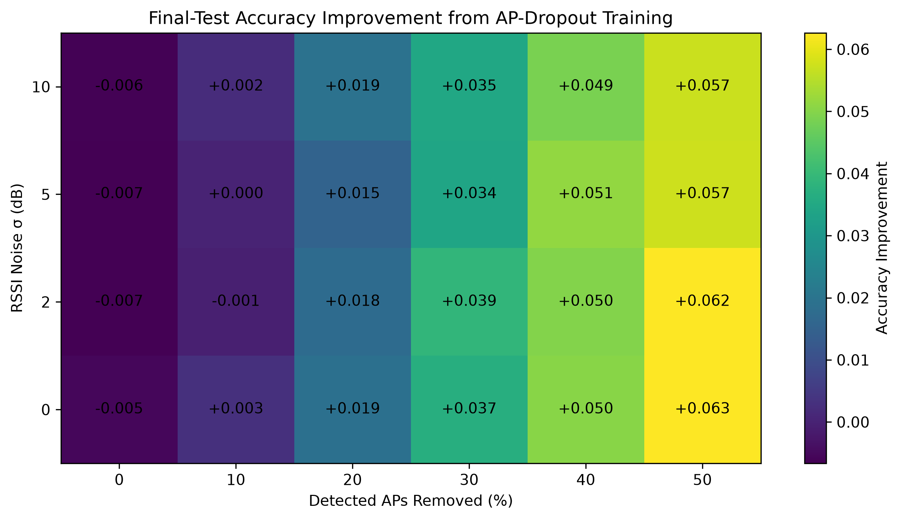

# Robust Wi-Fi Fingerprint-Based Indoor Localization Under Access-Point Loss and RSSI Noise


A reproducible machine-learning study investigating the robustness of
Wi-Fi fingerprint-based indoor localization under **access-point (AP) loss**
and **RSSI measurement noise**.

The study evaluates classical and neural machine-learning models under
controlled Wi-Fi degradation and investigates whether
**AP-dropout and RSSI-noise augmentation during training** can improve
robustness.

The experiments use the **UJIIndoorLoc** benchmark and evaluate both:

- **Building-floor classification**
- **Coordinate localization**

The final models are evaluated using a held-out test set that was not used
for model selection or hyperparameter tuning.

---

## Research Overview

Wi-Fi fingerprint-based indoor localization can achieve strong performance
under clean conditions, but real-world Wi-Fi environments are dynamic.

Access points may:

- disappear,
- become temporarily unavailable,
- change signal strength,
- experience interference,
- or produce noisy RSSI measurements.

A model that performs well on clean fingerprints may therefore experience
substantial degradation after deployment.

This project systematically evaluates these effects and investigates
robustness-oriented training strategies.

---

## Main Research Questions

**RQ1.** How does increasing Wi-Fi access-point loss affect indoor
localization performance?

**RQ2.** How does RSSI measurement noise affect indoor localization
performance?

**RQ3.** Can AP-dropout and RSSI-noise augmentation during training improve
robustness?

**RQ4.** Which evaluated machine-learning models maintain stronger
performance under degraded Wi-Fi conditions?

---

## Research Hypothesis

> Models trained using simulated access-point loss and RSSI perturbation
> will exhibit lower performance degradation under corrupted Wi-Fi
> conditions than models trained only on clean Wi-Fi fingerprints.

---

# Key Findings

The experiments show that **access-point loss is substantially more
disruptive than RSSI noise alone**.

Robustness-oriented training improves performance particularly when the
Wi-Fi environment becomes heavily degraded.

<p align="center">
  
</p>

<p align="center">
  <em>
    Final held-out classification performance under
    50% AP loss and RSSI noise σ = 10 dB.
  </em>
</p>

---

## Final Held-Out Classification Results

Under the severe test condition:

**50% detected-AP loss + Gaussian RSSI noise σ = 10 dB**

| Training strategy | Accuracy |
|---|---:|
| Clean-trained MLP | **68.53%** |
| AP-dropout-trained MLP | **74.24%** |
| Improvement | **+5.71 percentage points** |

The paired hierarchical bootstrap analysis produced:

**95% confidence interval: +4.41 to +7.06 percentage points**

The interval excludes zero, providing evidence that the improvement is
consistent under the evaluated corruption process.

### Clean-condition trade-off

| Training strategy | Accuracy |
|---|---:|
| Clean-trained MLP | **91.09%** |
| AP-dropout-trained MLP | **90.55%** |
| Difference | **−0.54 percentage points** |

The clean-condition difference had a 95% bootstrap confidence interval of:

**−1.80 to +0.63 percentage points**

This indicates that the robustness improvement was achieved with only a
small clean-condition classification trade-off.

---

# Final Localization Results

For coordinate localization, the strongest robustness strategy used
**combined AP-dropout and RSSI-noise augmentation**.

Under the severe condition:

**50% detected-AP loss + Gaussian RSSI noise σ = 10 dB**

| Training strategy | Mean localization error |
|---|---:|
| Clean-trained MLP | **30.1632** |
| Combined-augmentation MLP | **15.2405** |
| Absolute reduction | **14.9227** |
| Relative reduction | **≈ 49.5%** |

> Localization errors are reported in **dataset coordinate units**.
> No unsupported conversion to physical meters is assumed.

<p align="center">
  
</p>

<p align="center">
  <em>
    Mean localization error under severe combined degradation.
  </em>
</p>

---

# Robustness Across the Full Evaluation Grid

The final robustness evaluation contains:

- **6 AP-loss levels**
- **4 RSSI-noise levels**
- **24 combined corruption conditions**
- **5 stochastic corruption seeds**

AP-loss levels:

```text
0%, 10%, 20%, 30%, 40%, 50%
```

RSSI Gaussian noise:

```text
σ = 0, 2, 5, 10 dB
```

### Classification

Across all 24 conditions:

| Training regime | Mean accuracy | Mean Macro F1 | Minimum accuracy | Maximum accuracy |
|---|---:|---:|---:|---:|
| Clean | 0.8218 | 0.8085 | 0.6853 | 0.9122 |
| AP Dropout | **0.8483** | **0.8361** | **0.7424** | 0.9055 |

### Localization

Across all 24 conditions:

| Training regime | Mean error | Median-condition error | Minimum error | Maximum error |
|---|---:|---:|---:|---:|
| Clean | 18.5953 | 16.9085 | 12.0538 | 30.1632 |
| Combined augmentation | **11.9318** | **11.6042** | **10.1136** | **15.2405** |

---

## Robustness Heatmap

<p align="center">
  
</p>

<p align="center">
  <em>
    Improvement from robustness-oriented training across
    AP-loss and RSSI-noise conditions.
  </em>
</p>

Additional figures are available in:

```text
results/figures/
```

---

# Dataset

This study uses the **UJIIndoorLoc** Wi-Fi fingerprinting benchmark.

Dataset characteristics used in this project:

| Characteristic | Value |
|---|---:|
| Official training fingerprints | 19,937 |
| Held-out final-test fingerprints | 1,111 |
| Wi-Fi AP features | 520 |
| Buildings | 3 |
| Floors | 5 |
| Building-floor classes | 13 |
| Undetected AP proportion | 96.54% |
| Average observed APs per fingerprint | ≈ 18 |

The original dataset represents undetected access points using the value
`100`.

For model input, this project converts undetected APs to:

```text
-110 dBm
```

while preserving an explicit observed-AP mask.

This distinction is important because corruption is applied only to APs that
were originally observed.

---

# Experimental Design

The experimental pipeline follows the structure below:

```text
                    UJIIndoorLoc
                         │
                         ▼
                Dataset Exploration
                         │
                         ▼
                   Preprocessing
                         │
              ┌──────────┴──────────┐
              │                     │
              ▼                     ▼
     Building-Floor            Coordinate
      Classification          Localization
              │                     │
              └──────────┬──────────┘
                         │
                         ▼
                 Clean Baselines
                KNN / RF / MLP
                         │
          ┌──────────────┼──────────────┐
          │              │              │
          ▼              ▼              ▼
       AP Loss       RSSI Noise      Combined
      Evaluation      Evaluation     Degradation
          │              │              │
          └──────────────┼──────────────┘
                         │
                         ▼
                 Robust Training
             ┌───────────┼───────────┐
             │           │           │
             ▼           ▼           ▼
         AP Dropout   RSSI Noise    Combined
         Training     Training      Training
             │           │           │
             └───────────┼───────────┘
                         │
                         ▼
                Ablation Analysis
                         │
                         ▼
              Held-Out Final Test
                         │
                         ▼
            Bootstrap Statistical
                   Analysis
                         │
                         ▼
                 Final Results
```

---

# Machine-Learning Models

Three model families are evaluated.

## K-Nearest Neighbors

```text
n_neighbors = 5
weights = distance
```

KNN provides a strong fingerprint-matching baseline.

---

## Random Forest

```text
n_estimators = 300
random_state = 42
```

Random Forest provides a nonlinear ensemble baseline and demonstrated
strong resilience under AP-loss-only classification.

---

## Multilayer Perceptron

Architecture:

```text
Input
  ↓
128 hidden units
  ↓
64 hidden units
  ↓
Output
```

Configuration:

```text
Activation: ReLU
Optimizer: Adam
Maximum iterations: 300
Early stopping: enabled
Random state: 42
```

MLP was used for the final robustness-training experiments.

---

# Corruption Models

## Access-Point Loss

For each Wi-Fi fingerprint, a fraction of the **currently observed APs**
is randomly removed.

The tested loss levels are:

```text
0%
10%
20%
30%
40%
50%
```

Dropped access points are represented as:

```text
-110 dBm
```

Already-missing APs are not selected again.

---

## RSSI Noise

Gaussian perturbation is applied to observed RSSI measurements:

```text
RSSI_noisy = RSSI + ε
```

where:

```text
ε ~ N(0, σ²)
```

and:

```text
σ ∈ {0, 2, 5, 10} dB
```

Noise is applied only to observed APs.

In combined experiments, noise is applied only to APs that remain visible
after AP loss.

---

# Robust Training

Three augmentation strategies were investigated.

## AP-Dropout Augmentation

Training fingerprints are augmented with simulated AP-loss conditions.

## RSSI-Noise Augmentation

Training fingerprints are augmented with Gaussian RSSI perturbations.

## Combined Augmentation

Both access-point dropout and RSSI noise are introduced during training.

The ablation study demonstrated that the strongest augmentation strategy
depends on the task:

```text
Classification:
AP-dropout augmentation

Localization:
Combined AP-dropout + RSSI-noise augmentation
```

---

# Evaluation Metrics

## Classification

The following metrics are reported:

```text
Accuracy
Macro Precision
Macro Recall
Macro F1
Confusion Matrix
```

Macro averaging gives equal importance to each building-floor class.

---

## Localization

The following metrics are reported:

```text
Coordinate MAE
Coordinate RMSE
Mean Euclidean localization error
Median localization error
90th-percentile localization error
```

The Euclidean error for sample `i` is:

```text
e_i = sqrt(
    (x_pred - x_true)^2 +
    (y_pred - y_true)^2
)
```

---

# Statistical Analysis

The final comparison uses **paired bootstrap analysis**.

For corruption experiments, a hierarchical bootstrap accounts for:

1. variation across corruption realizations / random seeds, and
2. variation across held-out fingerprints.

The severe-condition classification improvement was:

```text
+5.71 percentage points
```

with:

```text
95% bootstrap CI = [4.41, 7.06] percentage points
```

The clean-condition classification difference was:

```text
-0.54 percentage points
```

with:

```text
95% bootstrap CI = [-1.80, 0.63] percentage points
```

---

# Repository Structure

```text
wifi-localization-research/
│
├── README.md
├── requirements.txt
├── research_plan.md
├── .gitignore
│
├── data/
│   ├── raw/
│   │   ├── trainingData.csv
│   │   └── validationData.csv
│   │
│   └── processed/
│
├── notebooks/
│   ├── 01_dataset_exploration.ipynb
│   ├── 02_preprocessing.ipynb
│   ├── 03_clean_baselines.ipynb
│   ├── 04_ap_loss_experiments.ipynb
│   ├── 05_rssi_noise_experiments.ipynb
│   ├── 06_combined_degradation.ipynb
│   ├── 07_robust_training.ipynb
│   ├── 08_final_evaluation.ipynb
│   ├── 09_statistical_analysis.ipynb
│   └── 10_final_figures_and_tables.ipynb
│
├── models/
│   ├── 03_clean_baselines/
│   └── 07_robust_training/
│
├── results/
│   ├── csv/
│   └── figures/
│
├── paper/
│   ├── figures/
│   ├── tables/
│   ├── final_results_summary.txt
│   └── publication_artifacts.csv
│
└── src/
```

---

# Notebook Workflow

The notebooks should be executed sequentially.

| Notebook | Purpose |
|---|---|
| `01_dataset_exploration.ipynb` | Dataset exploration and quality analysis |
| `02_preprocessing.ipynb` | Train/dev/test preparation and scaling |
| `03_clean_baselines.ipynb` | KNN, Random Forest and MLP clean baselines |
| `04_ap_loss_experiments.ipynb` | Controlled AP-loss robustness |
| `05_rssi_noise_experiments.ipynb` | Controlled RSSI-noise robustness |
| `06_combined_degradation.ipynb` | AP-loss × RSSI-noise experiment grid |
| `07_robust_training.ipynb` | Robust-training augmentation and ablation |
| `08_final_evaluation.ipynb` | Frozen held-out test evaluation |
| `09_statistical_analysis.ipynb` | Bootstrap statistical analysis |
| `10_final_figures_and_tables.ipynb` | Publication figures and LaTeX tables |

---

# Reproducing the Experiments

## 1. Clone the repository

```bash
git clone <YOUR-GITHUB-REPOSITORY-URL>
cd wifi-localization-research
```

---

## 2. Create a virtual environment

The original experiments were run using Python 3.11.

### macOS / Linux

```bash
python3.11 -m venv .envden702-wifi
source .envden702-wifi/bin/activate
```

### Windows

```bash
py -3.11 -m venv .envden702-wifi
.envden702-wifi\Scripts\activate
```

---

## 3. Install dependencies

```bash
python -m pip install --upgrade pip
pip install -r requirements.txt
```

---

## 4. Download UJIIndoorLoc

Download the official UJIIndoorLoc dataset from the
**UCI Machine Learning Repository**.

Place the two CSV files in:

```text
data/raw/
```

The structure should be:

```text
data/raw/
├── trainingData.csv
└── validationData.csv
```

---

## 5. Run the notebooks

Run the notebooks in numerical order:

```text
01 → 02 → 03 → 04 → 05
   → 06 → 07 → 08 → 09 → 10
```

The official validation portion is reserved for the final held-out
evaluation and must not be used for model selection.

---

# Reproducibility Protocol

The project follows several safeguards to reduce evaluation leakage.

### Training/development separation

The official UJIIndoorLoc training set is divided into:

```text
Training:     15,949 fingerprints
Development:  3,988 fingerprints
```

The split is stratified by combined building-floor class.

### Final test set

The official validation set contains:

```text
1,111 fingerprints
```

and remains untouched until the frozen final evaluation.

### Scaling

Feature scaling is fitted using the training partition only.

### Model selection

Models and augmentation strategies are selected using the development set.

### Final evaluation

The final test set is used only after the experimental methodology is
frozen.

No additional tuning is performed after observing final-test results.

---

# Output Files

Experimental result tables are written to:

```text
results/csv/
```

Experimental plots are written to:

```text
results/figures/
```

Publication-ready figures are written to:

```text
paper/figures/
```

LaTeX-ready tables are written to:

```text
paper/tables/
```

---

# Publication Figures

The final manuscript uses publication-quality versions of the major
experimental figures.

Examples include:

```text
fig_ap_loss_classification.pdf

fig_rssi_noise_classification.pdf

fig_final_classification_robustness.pdf

fig_final_localization_robustness.pdf

fig_accuracy_improvement_heatmap.pdf

fig_localization_error_reduction_heatmap.pdf

fig_classification_bootstrap_effect.pdf

fig_localization_bootstrap_effect.pdf
```

These files are available under:

```text
paper/figures/
```

---

# Research Contributions

The study makes four primary contributions.

1. **Controlled robustness evaluation**

   A systematic experimental framework quantifies the effects of
   access-point loss, RSSI noise, and simultaneous degradation on
   Wi-Fi fingerprint localization.

2. **Cross-model comparison**

   KNN, Random Forest, and MLP models are compared under identical clean
   and corrupted fingerprint conditions.

3. **Robustness-oriented augmentation**

   AP-dropout, RSSI-noise, and combined augmentation strategies are
   investigated as mechanisms for improving resilience.

4. **Held-out statistical validation**

   Final models are evaluated on an untouched held-out test set and
   paired bootstrap confidence intervals are used to quantify the
   robustness effects.

---

# Main Scientific Observation

The experiments indicate that:

> **Access-point disappearance is a substantially stronger source of
> degradation than moderate RSSI perturbation in the evaluated
> Wi-Fi fingerprinting setting.**

RSSI noise of σ = 10 dB produced relatively small degradation when used
alone, whereas removing 50% of the observed access points caused much
larger classification and localization deterioration.

Robustness-oriented training substantially mitigated this degradation,
particularly under combined AP-loss and RSSI-noise conditions.

---

# Limitations

The current study has several important limitations.

- Evaluation is based on the UJIIndoorLoc benchmark.
- Artificial corruption approximates AP disappearance and RSSI
  perturbation rather than measuring every possible real deployment
  failure.
- Device heterogeneity is not independently modeled.
- Temporal Wi-Fi infrastructure changes are not directly observed.
- Localization errors are retained in dataset coordinate units rather
  than being converted to meters without verified coordinate-system
  assumptions.
- Additional buildings and independent contemporary datasets would
  strengthen external validity.

These limitations motivate future evaluation using live and longitudinal
Wi-Fi deployments.

---

# Future Work

Potential extensions include:

- validation on additional indoor-localization benchmarks,
- longitudinal Wi-Fi fingerprint collection,
- device-independent robustness evaluation,
- reliability-aware AP weighting,
- uncertainty-aware localization,
- self-supervised fingerprint representation learning,
- domain adaptation across buildings,
- hybrid Wi-Fi / BLE / inertial localization,
- and real-time mobile deployment studies.

---

# Academic Context

This repository accompanies the research study:

> **Robust Wi-Fi Fingerprint-Based Indoor Localization Under Access-Point
> Loss and RSSI Noise**

The work was prepared as an original PhD-level research project for
**DEN702 — Advanced Research Communication** at **Abu Dhabi University**.

The experimental pipeline and final evaluation were frozen before the
manuscript was finalized.

---

# Research Paper

The manuscript reports:

- problem formulation,
- related work and research gap,
- mathematical corruption models,
- machine-learning methodology,
- robustness augmentation,
- baseline experiments,
- ablation analysis,
- held-out evaluation,
- bootstrap statistical analysis,
- limitations,
- and future research directions.

The final paper source is maintained separately in Overleaf.

---

# Citation

If you use this repository or build on the experimental framework, please
cite the corresponding research paper once publication details become
available.

For now:

```bibtex
@unpublished{wifi_localization_robustness_2026,
  title  = {Robust Wi-Fi Fingerprint-Based Indoor Localization
            Under Access-Point Loss and RSSI Noise},
  author = {YOUR FULL NAME},
  year   = {2026},
  note   = {PhD research project, Abu Dhabi University}
}
```

Replace `YOUR FULL NAME` with the final author name before publishing the
repository.

---

# Repository Versioning

The code corresponding to the submitted research paper should be preserved
using a Git tag.

Recommended release:

```bash
git tag -a v1.0-den702-paper \
  -m "Code and results used for DEN702 research paper"

git push origin v1.0-den702-paper
```

Recommended release title:

```text
DEN702 Research Paper — Reproducibility Release v1.0
```

This preserves the exact experimental version even if the repository is
extended later.

---

# Data Availability

The project relies on the publicly available **UJIIndoorLoc** benchmark.

The raw benchmark should be obtained from its official repository rather
than redistributed unnecessarily in this GitHub repository.

Users should place the downloaded files under:

```text
data/raw/
```

Processed data can then be regenerated using:

```text
02_preprocessing.ipynb
```

---

# Code Availability

All code required to reproduce preprocessing, baseline training,
robustness experiments, augmentation studies, held-out evaluation,
statistical analysis, and publication figures is provided in this
repository.

The notebooks intentionally preserve the complete experimental sequence so
that the relationship between model development and final evaluation is
auditable.

---

# Responsible Reproducibility

The final-test results in this repository must not be interpreted as a
development benchmark.

The final evaluation was frozen after model selection.

Any subsequent model modifications should therefore be treated as a
**new experiment** rather than used to retroactively modify the reported
results.

---

# License

A software license should be selected before making the repository public.

For academic research code, commonly used options include:

```text
MIT License
Apache License 2.0
BSD 3-Clause License
```

The license selected for this repository should apply only to original
code and should not override the terms associated with third-party
datasets or external resources.

---

# Contact

**Author:** YOUR FULL NAME  
**Program:** PhD in Intelligent Systems Engineering  
**Institution:** Abu Dhabi University  
**Location:** Abu Dhabi, United Arab Emirates  
**Email:** YOUR ACADEMIC EMAIL

---

## Project Status

```text
Dataset preparation             ✅ Complete
Clean baseline experiments      ✅ Complete
AP-loss experiments             ✅ Complete
RSSI-noise experiments          ✅ Complete
Combined degradation            ✅ Complete
Robust-training ablation        ✅ Complete
Held-out final evaluation       ✅ Complete
Bootstrap statistical analysis  ✅ Complete
Publication figures/tables      ✅ Complete
Research paper                  ✅ Prepared
```

**Experimental pipeline status: FROZEN**

No additional model tuning should be performed using the held-out test
results.